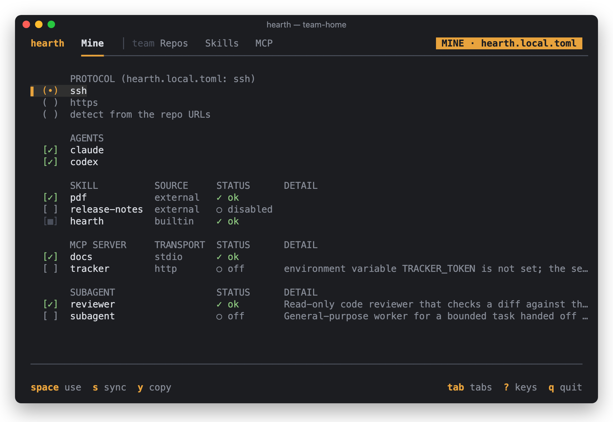
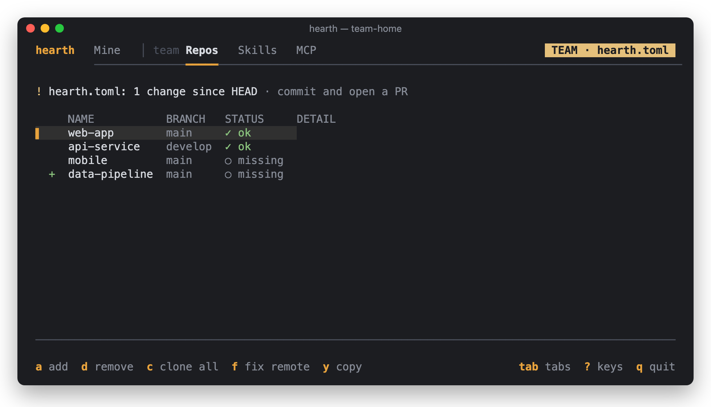

# hearth

English | [繁體中文](README.zh-TW.md)

hearth sets up and maintains a team's Home Repo: one Git repo that holds the rules, memory, and workflows your engineers and AI coding agents share, plus the list of product repos the team works on. Each person clones the products with their own SSH or HTTPS setting and picks which skills, MCP servers, and subagents their Claude Code or Codex sessions load. The team list changes through pull requests; personal choices never enter Git.

- **One binary.** Written in Go. No Node.js or Python runtime to install.
- **Team list, personal picks.** `hearth.toml` is reviewed like code. `hearth.local.toml` is git-ignored, so one person's setup never leaks into the shared repo.
- **One definition, two agents.** The same skill, MCP server, and subagent entries are written out for both Claude Code and Codex.
- **Pinned skills.** External skills are pinned to a commit, so everyone runs the same version.
- **No secrets in files.** MCP config names environment variables only; there is no field for a value.
- **Your edits are safe.** `hearth sync` never overwrites or deletes a generated file you edited by hand, unless you pass `--force`.



## Contents

- [Requirements](#requirements)
- [Installation](#installation)
- [Quick start](#quick-start)
- [How it works](#how-it-works)
- [Terminal UI](#terminal-ui)
- [Commands](#commands)
- [Upgrading](#upgrading)
- [Known limitations](#known-limitations)
- [Development](#development)
- [License](#license)

## Requirements

- macOS or Linux, on amd64 or arm64.
- Git.
- Go 1.27.4 or newer, to install from source.
- Read access to the product repos. For SSH, a working SSH key.
- Optional: the `claude` or `codex` CLI. hearth only warns when an agent you chose is not on your `PATH`.

## Installation

### Release binary

```sh
curl -fsSL https://raw.githubusercontent.com/CTHua/hearth/main/install.sh | sh
```

The script picks the archive for your platform (`darwin` or `linux`, `amd64` or `arm64`), downloads it with `SHA256SUMS` from the Release, checks the SHA-256, and installs `hearth` into `~/.local/bin`. It does not use sudo or edit your shell profile; when the directory is not on your `PATH`, it prints the line to add. If the checksum does not match, nothing is installed and an existing `hearth` stays as it was.

| Variable | Default | Meaning |
| --- | --- | --- |
| `HEARTH_VERSION` | the latest Release | Version to install, `0.1.0` or `v0.1.0` |
| `HEARTH_INSTALL_DIR` | `$HOME/.local/bin` | Directory to install into, created if missing |
| `HEARTH_BASE_URL` | `https://github.com/CTHua/hearth/releases` | Download root, for mirrors and tests |

```sh
curl -fsSL https://raw.githubusercontent.com/CTHua/hearth/main/install.sh | HEARTH_VERSION=0.1.0 sh
```

Every Release archive has a build provenance attestation. The script does not check it; to check a downloaded archive yourself with the GitHub CLI:

```sh
gh attestation verify hearth_linux_amd64.tar.gz --repo CTHua/hearth
```

### From source

```sh
go install github.com/CTHua/hearth/cmd/hearth@latest
```

Or build from a checkout:

```sh
go build -o bin/hearth ./cmd/hearth
```

A build without an injected version prints `dev` for `hearth version`. Release builds inject it:

```sh
go build -ldflags "-X github.com/CTHua/hearth/internal/version.Version=0.1.0" -o bin/hearth ./cmd/hearth
```

## Quick start

### 1. Create the Home Repo (once per team)

```sh
hearth init team-home             # needs a missing or empty directory; runs git init, does not commit
cd team-home
hearth repo add git@git.example.com:acme/web-app.git --description "Customer-facing web app"
hearth repo add https://git.example.com/acme/api.git --name api-service --branch develop
hearth repo describe api-service "Orders API"
```

`repo add` takes the name and path from the URL (`products/<name>`) and asks the remote for its default branch when you leave out `--branch`. The optional `description` says what each product is for, so an agent can tell which product a task belongs to; set or change it later with `repo describe`, and `doctor` warns about repos without one. Commit the result and push it to your Git host like any other repo.

### 2. Clone the products (every teammate)

```sh
git clone <your Home Repo URL> team-home
cd team-home
hearth config protocol ssh        # or https; leave it unset to detect on the first clone
hearth clone                      # clones every chosen product that is not cloned yet
hearth repo list
```

```text
NAME         PATH                  BRANCH   STATUS  DETAIL  DESCRIPTION
web-app      products/web-app      main     ok              Customer-facing web app
api-service  products/api-service  develop  ok              Orders API
```

Each product is its own Git repo under `products/`. The Home Repo ignores that directory.

You do not have to clone every product. `repos` in `hearth.local.toml` lists the ones you want; without that key every repo in `hearth.toml` counts as chosen. Once the key is there, a repo the team adds later is not chosen until you add it, and `repos = []` chooses none. The Mine tab of the terminal UI turns each repo on and off. `hearth clone` with no names clones only the chosen repos (`hearth clone <name>` clones that repo whether or not it is chosen), and `hearth repo list` shows `not-selected` for a repo that is neither chosen nor cloned. Turning a repo off never deletes its checkout.

```toml
schema_version = 3
protocol = "ssh"
repos = ["web-app"]
```

### 3. Pick skills, MCP servers, and subagents

```sh
hearth config agents claude,codex
hearth skill enable pdf
hearth mcp enable docs
hearth subagent enable reviewer
hearth sync                       # clones chosen repos not cloned yet, installs skills, writes MCP config and subagent files
hearth doctor                     # checks git, both config files, every checkout and every choice
```

Run `hearth` with no arguments to do the same in the terminal UI.

## How it works

hearth reads two files from the Home Repo root. It finds the root by walking up from the current directory until it sees `hearth.toml`, so it also works inside `products/<name>/`. Use `-C <dir>` to start somewhere else.

| File | Holds | Who changes it | In Git |
| --- | --- | --- | --- |
| `hearth.toml` | product repos, external skills, MCP servers | the team, through a PR | yes |
| `hearth.local.toml` | protocol, agents, chosen repos, enabled skills, MCP servers, subagents | each person | no |

Team skills live in `skills/<name>/` and team subagents in `subagents/<name>.md`, both committed. `hearth sync` first clones each chosen repo that has no checkout yet, with the same lines as `hearth clone`; it leaves repos that are already cloned alone, and a failed clone does not stop the rest, though it makes the exit code `1`. Then it turns the enabled items into files each agent reads:

| Item | Claude Code | Codex |
| --- | --- | --- |
| Skills | `.claude/skills/` | `.agents/skills/` |
| MCP servers | `.mcp.json` | `.codex/config.toml` |
| Subagents | `.claude/agents/<name>.md` | `.codex/agents/<name>.toml` |

All of these are git-ignored. hearth records a SHA-256 of each MCP and subagent file it writes in `.hearth/state.json`, and uses it to spot hand edits. It refuses to write one when a symlink sits in its path, even with `--force`. hearth writes only inside the Home Repo; it does not touch `~/.claude` or `~/.codex`.

Start your agent from the Home Repo root. Claude Code started inside `products/<name>/` still reads the root `CLAUDE.md`, but not the skills in `.claude/skills/`.

## Terminal UI

`hearth` in a terminal, inside a Home Repo, opens the UI; `hearth ui` always does. It needs at least 80×24.



- **Mine** edits `hearth.local.toml`: protocol, agents, and a switch for each repo, skill, MCP server, and subagent. `s` runs `hearth sync`, which also clones the chosen repos. If you changed an agent, repo, skill, MCP server, or subagent and have not synced since, `q` closes the UI and runs `hearth sync` in the terminal, with the same output and exit code; `ctrl+c` closes it without syncing, and changing only the protocol does not count.
- **Repos** shows `not-selected` for a repo you have not chosen and not cloned; `c` clones the chosen repos.
- **Repos, Skills, MCP** edit `hearth.toml`. `a` adds, `d` twice removes. The header counts changes since `HEAD`, and changed rows carry `+` (added) or `~` (changed).
- `?` lists every key. `y` copies the selected row's URL through OSC 52. `m` turns the mouse off so you can select text.

The add form for MCP servers takes a command, URL, and environment variable names. Set bearer tokens and header variables with `hearth mcp add`.

## Commands

| Group | Commands |
| --- | --- |
| Repos | `repo add`, `repo remove`, `repo describe`, `repo list`, `repo fix-remote`, `clone` |
| Skills | `skill add`, `skill update`, `skill remove`, `skill enable`, `skill disable`, `skill sync`, `skill list` |
| MCP servers | `mcp add`, `mcp remove`, `mcp enable`, `mcp disable`, `mcp sync`, `mcp list` |
| Subagents | `subagent enable`, `subagent disable`, `subagent sync`, `subagent list` |
| Personal | `config protocol`, `config agents` |
| Whole repo | `init`, `sync`, `doctor`, `upgrade`, `ui`, `version` |

`hearth help` prints every command with its flags. A few examples:

```sh
hearth skill add https://git.example.com/acme/skills.git --subdir pdf   # pins the remote's HEAD
hearth skill add https://git.example.com/acme/toolkit.git               # lists its skills; several become one group
hearth skill enable toolkit                                             # a group's name enables all of its skills
hearth mcp add docs --env-var DOCS_TOKEN -- npx -y @acme/docs-mcp       # stdio server
hearth mcp add tracker --url https://mcp.example.com/mcp --bearer-token-env TRACKER_TOKEN
hearth repo fix-remote            # points origin at the expected URL when only the protocol differs
```

`hearth repo remove` edits `hearth.toml` only and keeps the checkout.

A repo that holds several skills is added as one group: a single `[[skills]]` entry with `subdirs` instead of `subdir`, one commit and one checkout in `vendor/skills/<group>` for all of them. Without `--subdir`, `skill add` clones the repo into the system's temporary directory without a checkout, lists every `SKILL.md`, and removes the clone; when the repo has `.claude-plugin/plugin.json`, its `skills` paths pick the members and its `name` names the group. Each skill keeps the last segment of its directory as its name, so `skill enable grilling` turns on one and `skill enable <group>` all of them. `skill remove <member>` takes one skill out of its group (`skill remove <group>/<member>` when several groups have a skill of that name), and `skill update <group>` moves the whole group's pin. `skill list` shows a `GROUP` column.

Exit codes: `0` success, `1` a repo, skill, or generated file failed, `2` config, usage, environment, or version error, `130` interrupted. Errors print as `error [<category>] <message>`.

The Home Repo that `hearth init` writes has its own README with every file format, rule, and error category. Its source is [`template/home/README.md`](template/home/README.md).

## Upgrading

After you install a newer hearth, run this in each Home Repo:

```sh
hearth upgrade --check            # lists what would change; exits 1 if anything would
hearth upgrade
```

`upgrade` rewrites only the text between the `hearth:begin` and `hearth:end` markers in `AGENTS.md` and `.gitignore`, and moves each config file to its current `schema_version`. Everything outside the markers stays byte for byte the same. If a marker is missing, repeated, or out of order, it exits 2 and writes nothing.

hearth 0.2.0 reads only `schema_version = 2`, which added skill groups. Its `upgrade` changes just two values in place: `schema_version` from 1 to 2 in both files, and `min_hearth_version` in `hearth.toml` to `0.2.0` when it is lower. Comments, blank lines and key order are kept. Commit the upgraded `hearth.toml` in a PR; teammates on 0.1.0 then need to install 0.2.0, and each person runs `hearth upgrade` once for their own `hearth.local.toml`.

This version reads `hearth.toml` at `schema_version = 2`, as 0.2.0 does, and `hearth.local.toml` at `schema_version = 3`, which added `repos`. Its `upgrade` changes only the personal file's `schema_version` from 2 to 3 (from 1, it goes on to 3); `hearth.toml` and its `min_hearth_version` stay as they are, so teammates still on 0.2.0 can keep reading the team file. Without a `repos` key every repo is chosen, so the first `hearth sync` after upgrading clones every repo that is not cloned yet, which can take a while on a large team. To avoid that, turn repos off on the Mine tab, or write `repos = []` (or the list you want) in `hearth.local.toml`, before you sync. The `hearth clone` line in the marked section of `AGENTS.md` changed too, so `doctor` warns about that section until you run `upgrade`.

A Home Repo created with hearth 0.2.0 or earlier has its files in Traditional Chinese. `upgrade` turns only the marked section of `AGENTS.md` into English; the other files stay as they are, so translate them yourself if you want them to match.

## Known limitations

- Codex subagents are untested. The `.codex/agents/<name>.toml` files follow the Codex docs, but a 2026-11-18 run with Codex 0.162.1 did not apply the definition to the named role.
- Codex reads the project's `.codex/config.toml` only in a trusted project. Claude Code asks you to approve the servers in `.mcp.json`.
- Repo URLs must be `git@<host>:<path>`, `ssh://git@<host>/<path>`, or `https://<host>/<path>`.

## Development

```sh
gofmt -l .
go vet ./...
go test ./...
```

Tests do not touch the network: remotes are temporary bare repos, and git's `insteadOf` points the URLs at them. [`AGENTS.md`](AGENTS.md) has the package layout and the rules for changes.

## License

MIT. See [`LICENSE`](LICENSE).
