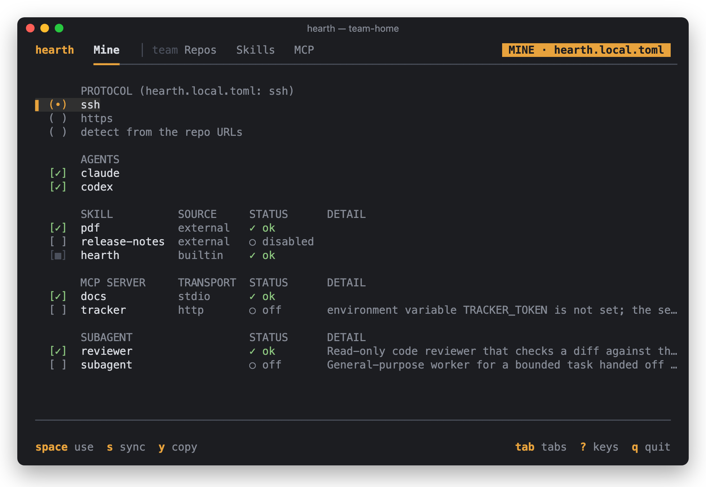
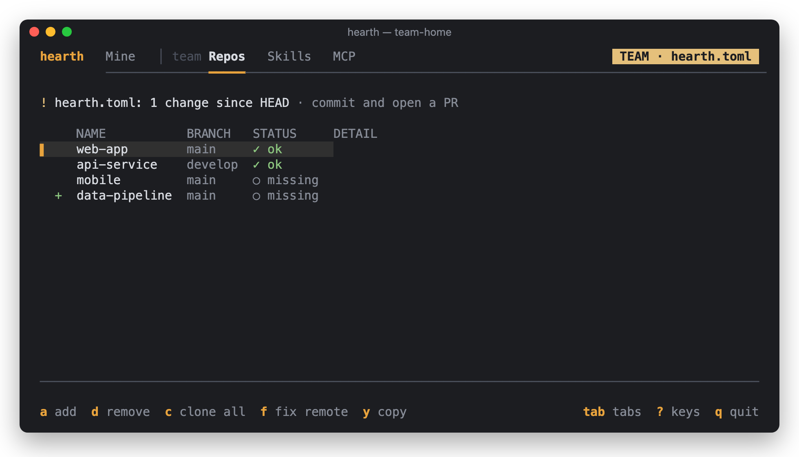

# hearth

[English](README.md) | 繁體中文

hearth 幫團隊建立並維護 Home Repo：一個 Git repo，放工程師和 AI coding agent 共用的規則、記憶、workflows，以及團隊負責的產品 repo 清單。每個人照自己的 SSH 或 HTTPS 設定 clone 產品，再自己選 Claude Code 或 Codex 要載入哪些 skill、MCP server 和 subagent。團隊清單透過 PR 修改；個人選擇不進 Git。

- **單一執行檔。** 用 Go 寫，不用另外裝 Node.js 或 Python。
- **團隊清單、個人選擇分開。** `hearth.toml` 跟程式碼一樣走 review；`hearth.local.toml` 被 git 忽略，個人設定不會混進共用 repo。
- **一份定義，兩種 agent。** 同一份 skill、MCP server、subagent 設定，同時產生給 Claude Code 和 Codex。
- **skill 釘在 commit。** 外部 skill 釘在指定的 commit，所有人跑同一個版本。
- **檔案裡沒有秘密。** MCP 設定只寫環境變數名稱，沒有欄位可以放值。
- **不蓋掉你手改的檔。** 產生的檔被手改過，`hearth sync` 不覆寫也不刪，除非加 `--force`。



> [!NOTE]
> hearth 還沒正式發布，也還沒有 tag 過的 release。第一次發布前，設定檔格式還可能改。

## 目錄

- [環境需求](#環境需求)
- [安裝](#安裝)
- [快速開始](#快速開始)
- [運作方式](#運作方式)
- [終端介面](#終端介面)
- [指令](#指令)
- [升級](#升級)
- [已知限制](#已知限制)
- [開發](#開發)
- [授權](#授權)

## 環境需求

- macOS 或 Linux，amd64 或 arm64。
- Git。
- 從原始碼安裝需要 Go 1.27.4 以上。
- 對產品 repo 有讀取權限；用 SSH 的話要先設好 SSH key。
- 選用：`claude` 或 `codex` CLI。選了的 agent 不在 `PATH` 上時，hearth 只會警告。

## 安裝

### 下載發布版

```sh
curl -fsSL https://raw.githubusercontent.com/CTHua/hearth/main/install.sh | sh
```

這要有已發布的 GitHub Release，目前 hearth 還沒有。第一個 Release 出來之前，請用下面的 `go install` 從原始碼安裝。

腳本會挑這台平台的壓縮檔（`darwin` 或 `linux`，`amd64` 或 `arm64`），連同 `SHA256SUMS` 從 Release 下載，驗過 SHA-256 後把 `hearth` 裝到 `~/.local/bin`。不用 sudo，也不改 shell 設定檔；安裝目錄不在 `PATH` 上時，會印出要加的那一行。checksum 不符時什麼都不裝，原本的 `hearth` 不動。

| 環境變數 | 預設值 | 用途 |
| --- | --- | --- |
| `HEARTH_VERSION` | 最新的 Release | 要裝的版本，`0.1.0` 或 `v0.1.0` 都可以 |
| `HEARTH_INSTALL_DIR` | `$HOME/.local/bin` | 安裝目錄，不存在時會建立 |
| `HEARTH_BASE_URL` | `https://github.com/CTHua/hearth/releases` | 下載來源的根，給鏡像和測試用 |

```sh
curl -fsSL https://raw.githubusercontent.com/CTHua/hearth/main/install.sh | HEARTH_VERSION=0.1.0 sh
```

每個 Release 的壓縮檔都有 build provenance attestation。腳本不驗它；要自己驗下載的壓縮檔，用 GitHub CLI：

```sh
gh attestation verify hearth_linux_amd64.tar.gz --repo CTHua/hearth
```

### 從原始碼

```sh
go install github.com/CTHua/hearth/cmd/hearth@latest
```

或從 checkout 建置：

```sh
go build -o bin/hearth ./cmd/hearth
```

沒有注入版本的 build，`hearth version` 印 `dev`。發布用的 build 這樣注入：

```sh
go build -ldflags "-X github.com/CTHua/hearth/internal/version.Version=0.1.0" -o bin/hearth ./cmd/hearth
```

## 快速開始

### 1. 建立 Home Repo（每個團隊做一次）

```sh
hearth init team-home             # 目錄要不存在或是空的；會跑 git init，不會 commit
cd team-home
hearth repo add git@git.example.com:acme/web-app.git --description "Customer-facing web app"
hearth repo add https://git.example.com/acme/api.git --name api-service --branch develop
hearth repo describe api-service "Orders API"
```

`repo add` 從 URL 取名稱和路徑（`products/<name>`）；沒給 `--branch` 時問遠端的預設分支。選填的 `description` 寫這個產品做什麼，agent 靠它判斷任務屬於哪個產品；之後用 `repo describe` 補上或修改，`doctor` 會提醒沒寫的 repo。做完照一般 repo 的方式 commit，推到你們的 Git host。

### 2. clone 產品（每位成員）

```sh
git clone <你的 Home Repo URL> team-home
cd team-home
hearth config protocol ssh        # 或 https；不設的話，第一次 clone 時實際連線偵測
hearth clone                      # clone 所有還沒 clone 的產品
hearth repo list
```

```text
NAME         PATH                  BRANCH   STATUS  DETAIL  DESCRIPTION
web-app      products/web-app      main     ok              Customer-facing web app
api-service  products/api-service  develop  ok              Orders API
```

每個產品是 `products/` 底下獨立的 Git repo，Home Repo 忽略這個目錄。

### 3. 選 skill、MCP server 和 subagent

```sh
hearth config agents claude,codex
hearth skill enable pdf
hearth mcp enable docs
hearth subagent enable reviewer
hearth sync                       # 安裝 skill，寫出 MCP 設定和 subagent 檔
hearth doctor                     # 檢查 git、兩個設定檔、每個 checkout 和每個選擇
```

不帶參數跑 `hearth`，可以在終端介面做同樣的事。

## 運作方式

hearth 讀 Home Repo 根目錄的兩個檔案。它從目前目錄往上找 `hearth.toml` 決定根目錄，所以在 `products/<name>/` 裡也能跑；要從別處開始用 `-C <dir>`。

| 檔案 | 內容 | 誰改 | 進 Git |
| --- | --- | --- | --- |
| `hearth.toml` | 產品 repo、外部 skill、MCP server | 團隊，走 PR | 是 |
| `hearth.local.toml` | protocol、agent、選用的 skill、MCP server、subagent | 每個人自己 | 否 |

團隊自己寫的 skill 放 `skills/<name>/`，subagent 放 `subagents/<name>.md`，都進版控。`hearth sync` 把選用的項目轉成各 agent 讀的檔案：

| 項目 | Claude Code | Codex |
| --- | --- | --- |
| Skills | `.claude/skills/` | `.agents/skills/` |
| MCP servers | `.mcp.json` | `.codex/config.toml` |
| Subagents | `.claude/agents/<name>.md` | `.codex/agents/<name>.toml` |

這些檔案都被 git 忽略。hearth 把寫出的 MCP 和 subagent 檔的 SHA-256 記在 `.hearth/state.json`，用來判斷有沒有被手改；路徑上有 symlink 時，加 `--force` 也不寫。hearth 只寫 Home Repo 裡面，不碰 `~/.claude`、`~/.codex`。

agent 請從 Home Repo 根目錄啟動。Claude Code 從 `products/<name>/` 啟動時讀得到根目錄的 `CLAUDE.md`，但讀不到 `.claude/skills/` 的 skill。

## 終端介面

在 Home Repo 裡、在終端機跑 `hearth` 會開介面；`hearth ui` 一定會開。終端機至少要 80×24。



- **Mine** 改 `hearth.local.toml`：protocol、agent，以及每個 skill、MCP server、subagent 的開關。`s` 跑 `hearth sync`。
- **Repos、Skills、MCP** 改 `hearth.toml`。`a` 新增，`d` 按兩次移除。頁首列出跟 `HEAD` 比的改動數，有改動的列標 `+`（新增）或 `~`（內容不同）。
- `?` 列出所有按鍵。`y` 用 OSC 52 複製選到那列的 URL。`m` 關掉滑鼠，讓你能拖曳選字。

新增 MCP server 的表單只收 command、URL 和環境變數名稱；bearer token 和 header 變數用 `hearth mcp add` 設。

## 指令

| 類別 | 指令 |
| --- | --- |
| Repo | `repo add`、`repo remove`、`repo describe`、`repo list`、`repo fix-remote`、`clone` |
| Skill | `skill add`、`skill update`、`skill remove`、`skill enable`、`skill disable`、`skill sync`、`skill list` |
| MCP server | `mcp add`、`mcp remove`、`mcp enable`、`mcp disable`、`mcp sync`、`mcp list` |
| Subagent | `subagent enable`、`subagent disable`、`subagent sync`、`subagent list` |
| 個人設定 | `config protocol`、`config agents` |
| 整個 repo | `init`、`sync`、`doctor`、`upgrade`、`ui`、`version` |

`hearth help` 列出每個指令和旗標。幾個例子：

```sh
hearth skill add https://git.example.com/acme/skills.git --subdir pdf   # 釘在遠端 HEAD
hearth mcp add docs --env-var DOCS_TOKEN -- npx -y @acme/docs-mcp       # stdio server
hearth mcp add tracker --url https://mcp.example.com/mcp --bearer-token-env TRACKER_TOKEN
hearth repo fix-remote            # origin 只差協定時，改成預期的 URL
```

`hearth repo remove` 只改 `hearth.toml`，checkout 留著。

exit code：`0` 成功；`1` 有 repo、skill 或產生的檔案失敗；`2` 設定、用法、環境或版本錯誤；`130` 中斷。錯誤格式是 `error [<類別>] <說明>`。

`hearth init` 產生的 Home Repo 有自己的 README，寫了完整的檔案格式、規則和錯誤類別，來源在 [`template/home/README.md`](template/home/README.md)。

## 升級

裝了新版 hearth 之後，在每個 Home Repo 跑：

```sh
hearth upgrade --check            # 列出會改的地方；有要改的就 exit 1
hearth upgrade
```

`upgrade` 只重寫 `AGENTS.md`、`.gitignore` 裡 `hearth:begin` 和 `hearth:end` 標記之間的內容，並把兩個設定檔升到目前的 `schema_version`。標記外的內容逐 byte 不變。標記缺少、重複或順序錯時 exit 2，什麼都不寫。

## 已知限制

- `hearth init` 寫出的檔案（`AGENTS.md`、Home Repo 的 README、workflows）是繁體中文。
- Codex 的 subagent 還沒實測生效。`.codex/agents/<name>.toml` 照 Codex 官方文件產生，但 2026-11-18 用 Codex 0.162.1 試時，指名的角色沒有套用定義。
- Codex 只在 trusted project 讀專案的 `.codex/config.toml`；Claude Code 會要求你核准 `.mcp.json` 裡的 server。
- repo URL 只收 `git@<host>:<path>`、`ssh://git@<host>/<path>`、`https://<host>/<path>` 三種寫法。

## 開發

```sh
gofmt -l .
go vet ./...
go test ./...
```

測試不連網路：遠端是暫存的 bare repo，URL 用 git 的 `insteadOf` 導到本機。套件結構和修改規則見 [`AGENTS.md`](AGENTS.md)。

## 授權

MIT，見 [`LICENSE`](LICENSE)。
